<div align="center">


# Aperture Chat

**The self-hosted AI workspace for your organization.**<br>
Chat, documents, slide decks, spreadsheets, agents, automations, and knowledge, on infrastructure you control.

[](https://github.com/Aperture-Chat/Aperture-Chat/releases)
[](LICENSE.md)


[Features](#features) · [Get started](#get-started) · [Updates](#updates-and-images) · [Architecture](#architecture) · [Development](#development) · [Documentation](#documentation) · [License](#license)

<br>

<picture>
  <source media="(prefers-reduced-motion: reduce)" srcset="docs/images/product-tour-light.png">
  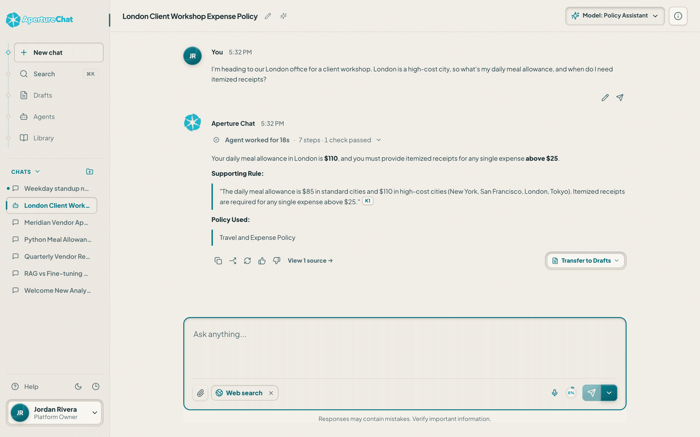
</picture>

<sub>The current interface in a synthetic organization, answered by an open model (Qwen 3.5 9B) running locally.
Watch the narrated walkthrough at <a href="https://aperturechat.com/#demoPanel">ApertureChat.com</a>.</sub>

</div>

## Why Aperture Chat

<table>
<tr>
<td width="33%" valign="top">

**Your infrastructure**<br>
Run the whole workspace with Docker Compose. Application data and encrypted
provider credentials stay in your deployment.

</td>
<td width="33%" valign="top">

**Any approved model**<br>
Connect OpenAI, Anthropic, Azure OpenAI, Google Gemini, OpenRouter, Ollama,
and other OpenAI-compatible providers, then decide who may use each model.

</td>
<td width="33%" valign="top">

**Built-in governance**<br>
Role-aware consoles, SSO and SCIM, group policies, audit trails, retention,
and analytics for the people responsible for AI use.

</td>
</tr>
</table>

Platform owners configure providers and organization-wide controls; tenant
administrators manage their people, groups, and sources; users work with the
models, knowledge, and tools assigned to them.

Requests to configured model providers, cloud connectors, and web search leave
your deployment when those features are used. Choose providers and access
policies appropriate for your organization's data.

> **Current release: [v0.5.23](https://github.com/Aperture-Chat/Aperture-Chat/releases/tag/v0.5.23)**:
> A chat reply can take research steps before it answers (search your knowledge,
> search the web, read a linked page, work out a figure); the Drafts assistant
> asks before it writes and takes the same steps for documents, decks, and
> spreadsheets; a **Check** key lists blanks, undefined terms, and missing
> exhibits in a document; and Agents, Automations, and AI actions gain legal,
> finance, and consulting starting points.
> v0.5.22 kept replies running on the server when you leave and added clarifying questions.
> See the [release notes](docs/DOCKER_RELEASE.md#new-since-v0522) and
> [all releases](https://github.com/Aperture-Chat/Aperture-Chat/releases).

## Features

### Chat

| Light | Dark |
| --- | --- |
| 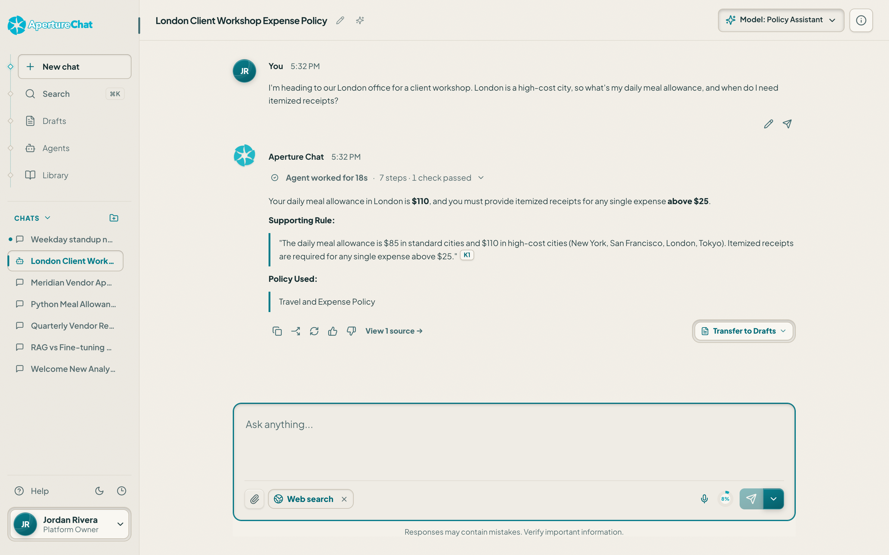 | 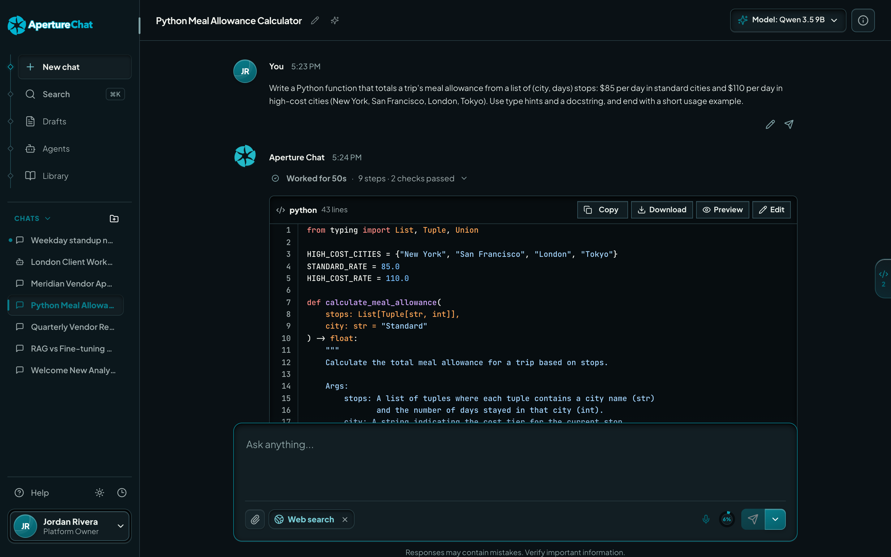 |
| 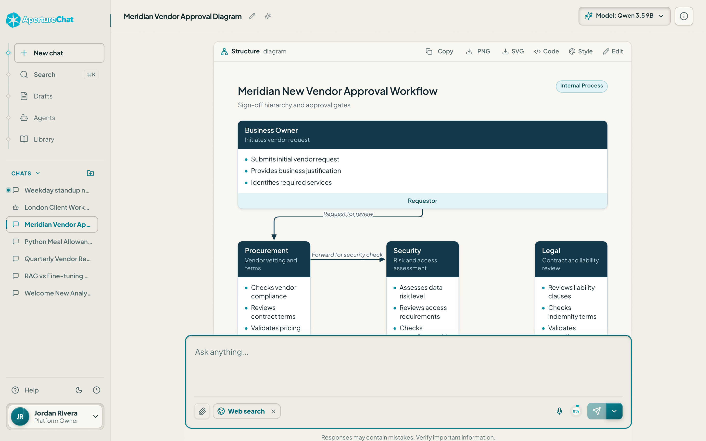 | 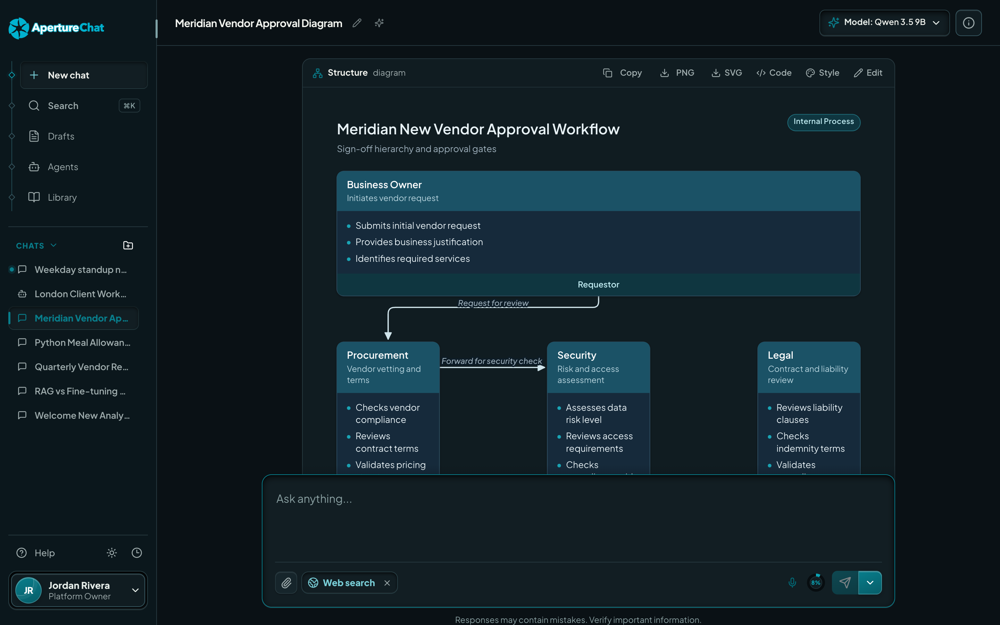 |

| Research steps | Clarifying questions |
| --- | --- |
| 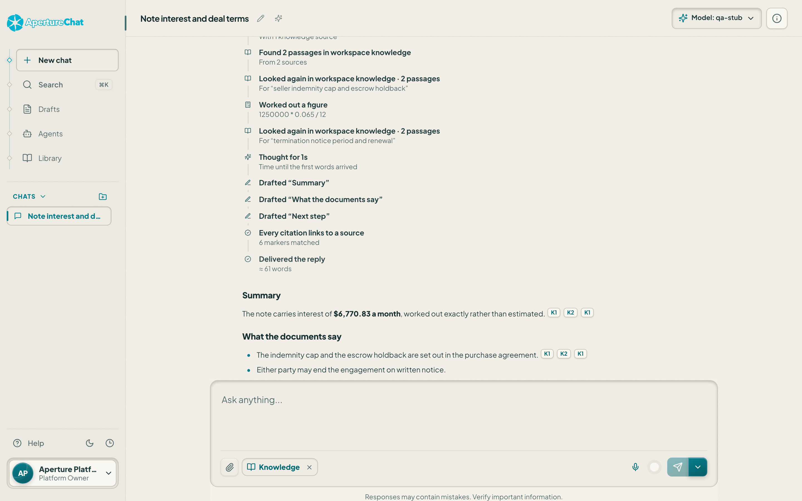 | 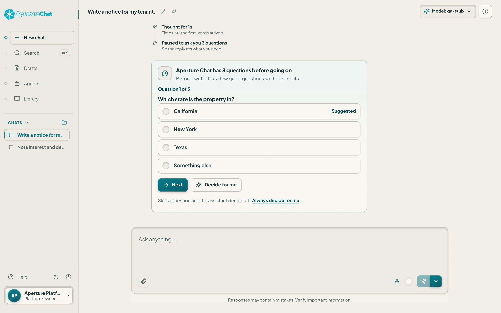 |

<sub>The two pictures above use a scripted stand-in model (shown as <code>qa-stub</code>), so the answer text is scripted; the question card, the steps, and the trace are the application's own. See <a href="docs/images/README.md">how the pictures were made</a>.</sub>

- **Approved models and agents.** Pick a model or agent for each conversation. Access follows provider, platform, tenant, group, user, and deny policies.
- **Grounded answers.** Use attachments, knowledge bases, connected documents, and web search, then open the citations behind an answer. Attached files are kept and open in the document viewer, and typing `#` brings a knowledge file or a whole base into the message as a block you can check before you send.
- **Research steps.** Before it answers, a reply can search your knowledge again, search the web, read a linked page, or work out a figure exactly, up to three rounds of four steps. Each step shows in the work trace with what it looked for. Steps use only the knowledge and web access already allowed for that message, and Fast replies skip them.
- **Clarifying questions.** When a request is unclear, a reply pauses to ask up to three multiple-choice questions, one at a time, with a suggested choice. **Decide for me** lets the assistant choose and say what it assumed, and the **Ask me when unclear** switch in Send options turns questions off.
- **Replies that keep running.** A reply runs on the server, so it keeps going when you reload, close the browser, or switch to another chat, and it is there when you come back. **Stop** ends it.
- **Code and diagrams.** Code blocks are colored, editable in place, and offer **AI edit** on a highlighted selection; **Download** names the file from its contents, and HTML previews open in a canvas. Ask for a diagram and get a structure chart you can restyle with eight themes, rearrange by dragging, and export as PNG or SVG.
- **Client-matter numbers.** File a chat under a client-matter number from the **Matter** row in **Send options**. Numbers you type are saved for reuse, and the same numbers tag knowledge bases, so records staff can find a matter's chats in retention and its knowledge bases in Library search.
- **Dictation.** Speak into the composer's microphone. Transcription uses a Gemini Flash model or a speech model such as Whisper or gpt-4o-transcribe (on Groq, OpenAI, Azure OpenAI, or Azure AI Foundry), and a busy or unreachable model hands the recording to the next one.
- **Work traces.** Review the steps, sources, and provider-reported usage behind each reply, live while it streams. Provider-reported usage depends on the provider.
- **Response actions.** Copy, share, regenerate, rate, and transfer an answer to Drafts.
- **Organized history.** Search conversations and keep them tidy with folders, pins, and archives. Read state follows your account across browsers.

<details>
<summary><b>Mobile layout</b></summary>
<br>
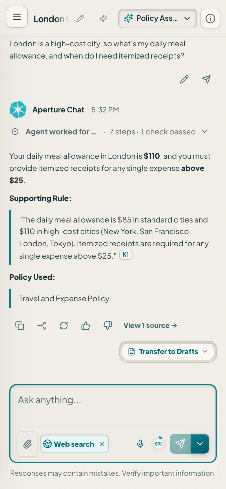
</details>

### Documents, slide decks, and spreadsheets

| Document editor | Slide editor |
| --- | --- |
| 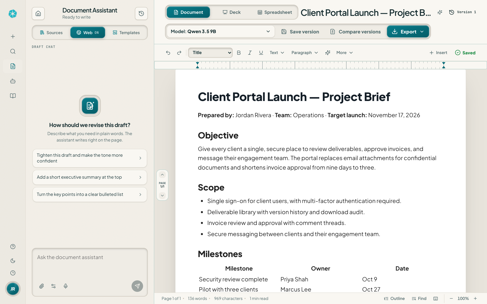 | 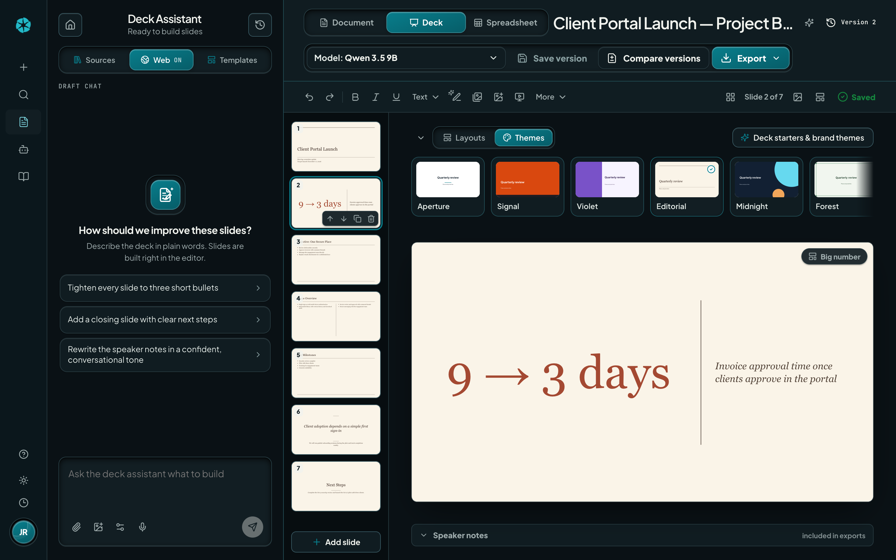 |

| Spreadsheet | Pivot table |
| --- | --- |
| 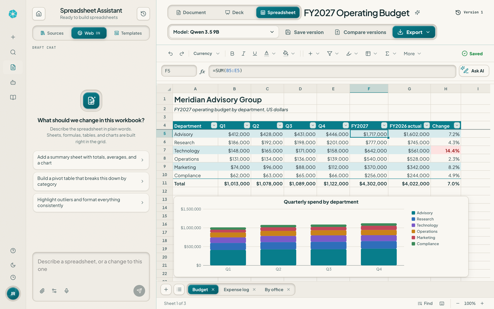 | 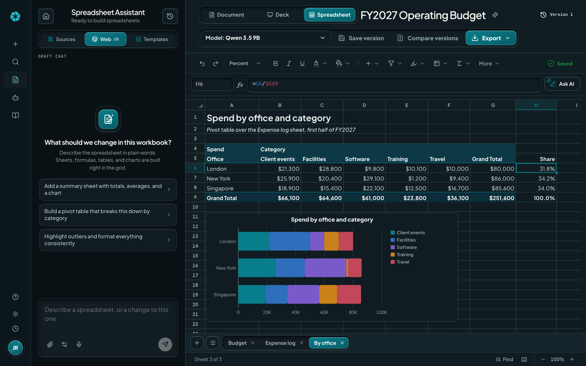 |

- **One workspace, three formats.** Switch between **Document**, **Deck**, and **Spreadsheet** in Drafts. Manual editing, import, saving, and export work even before AI drafting is configured.
- **Spreadsheets.** Build multi-sheet workbooks with Excel-style formulas, tables, pivot tables, and charts, open and export `.xlsx` and `.csv` files, and ask the **Spreadsheet Assistant** to edit a selection or build whole tables.
- **Drafting context.** Choose templates, upload a Word template, attach files, select knowledge, and control web search from the assistant rail. **Open in editor** opens a Word or PDF file with its page setup, headers, footers, and tables intact, a Markdown or text file as the document, or a PowerPoint file as the deck. Ask for page layout in plain words and it is applied without rewriting a word.
- **Start from chat.** Ask for a document, a deck, or a spreadsheet in chat and choose **Write in Drafts** or **Build in deck editor** on the card that appears; the request and its context carry over with no retyping.
- **Asks before it writes.** When a drafting request leaves something open, the assistant asks one to three multiple-choice questions under your request, for documents, decks, and spreadsheets, then writes with your answers. **Decide for me** skips them, and **Ask me when unclear** in the assistant's settings turns them off; chat shares the same switch.
- **Research while it writes.** A writing request can search your knowledge, search the web, read a linked page, or work out a figure before it writes, and the steps it took are listed in the draft chat.
- **Check.** The **Check** key in the document status bar reads the page and lists blanks and placeholders still to fill in, defined terms that are never used or never defined, exhibits and sections that are mentioned but missing, and numbering that skips or repeats. Choose an item to jump to it. The checks run in the browser without a model.
- **Edit with AI.** Select text and choose **Ask AI**, or rework a whole slide with **Edit slide with AI**. Every suggestion is reviewed before it replaces anything, and word-level edits keep the original formatting. A **Legal & business** group adds actions such as **Tighten this clause**, **Break into numbered sub-clauses**, **Lead with the conclusion**, and **Make figures consistent**; decks add **Write a takeaway title**, and spreadsheets add **Add variance columns** and **Check that the totals add up**.
- **Editor tools.** A `/` command menu, Markdown shortcuts, find and replace, a heading outline, zoom, and table and picture tools. For decks, a slide panel adds slides, changes layouts (including statement, big-number, and picture-with-bullets), and places pictures with alt text; a floating text toolbar formats text, overflowing text shrinks to fit as in PowerPoint, and seven theme designs, a slide sorter, snapping guides, and presenter view round it out.
- **Share and edit together.** Every draft starts private. **Share** offers **Only me**, **My group**, or **Specific people**; group shares follow current group membership, and a draft in a matter is shared only with people on that matter. A shared draft saves itself into one live copy, two people can edit at once, and their changes merge (documents by paragraph and word, decks by slide, spreadsheets by cell) while colored initials show who else is in it. Only the owner changes sharing, archives, or deletes it.
- **Versions you can trust.** Save versions, compare and return to versions while a draft is open, preview history, and archive drafts. On a shared draft every saved version records who saved it and **Bring back** restores it for everyone. Entries marked **Local only** stay in the browser, so export a copy before switching devices.
- **Academic formatting.** MLA-aware layout with double spacing, first-line indents, and reference formatting.
- **Export.** Download Word (`.docx`), Markdown (`.md`), PowerPoint (`.pptx`), or Excel (`.xlsx`), build an archival PDF/A file, or print.

| Asks before it writes | Check |
| --- | --- |
| 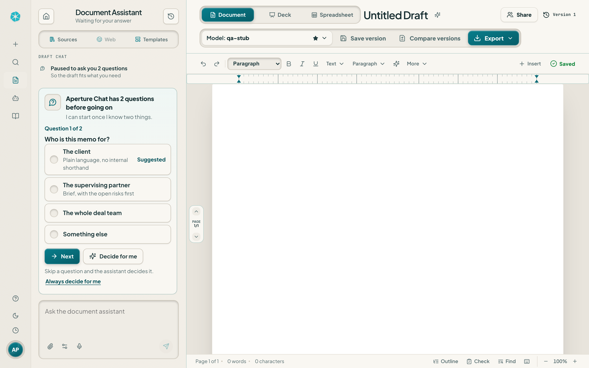 | 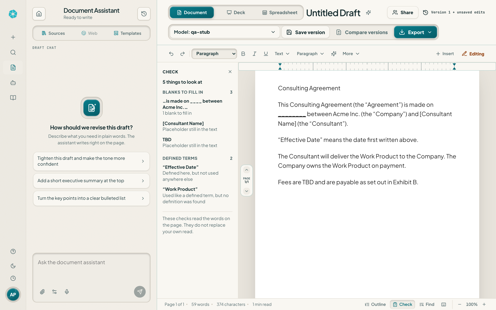 |

<sub>The question card on the left came from the same scripted stand-in model. The Check panel uses no model.</sub>

<p align="center">
  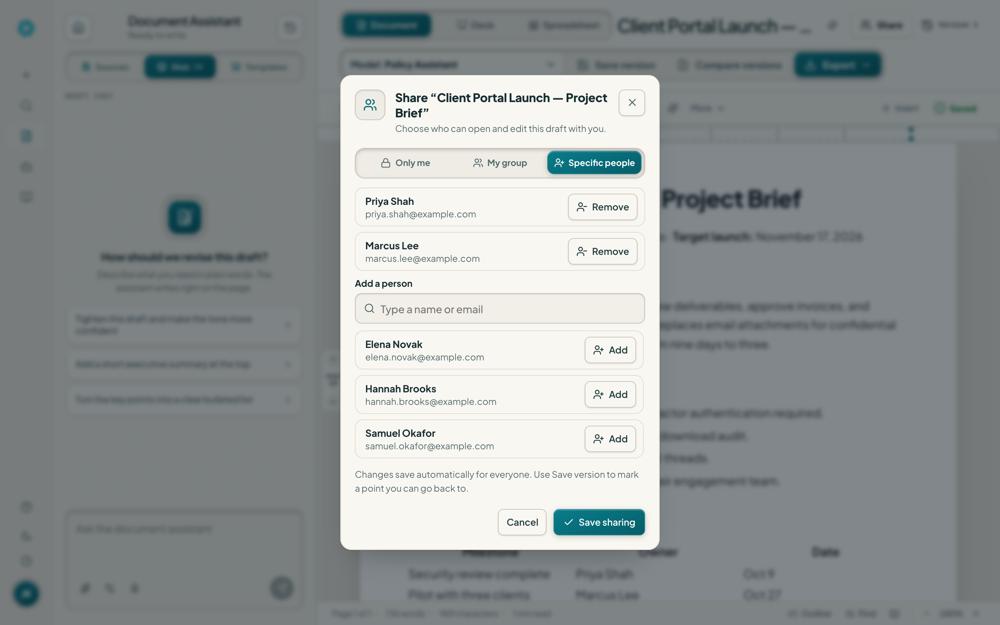
</p>

<details>
<summary><b>Document in dark mode, deck in light mode</b></summary>
<br>

| Document, dark | Deck, light |
| --- | --- |
| 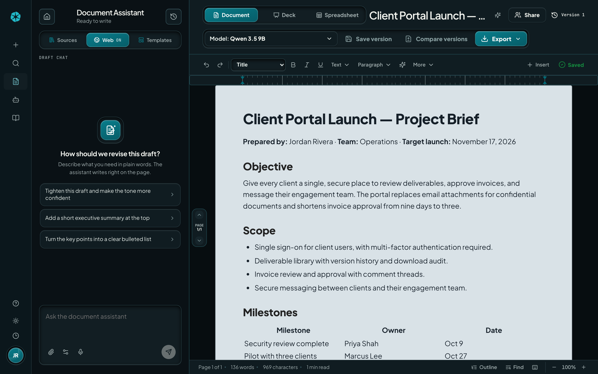 | 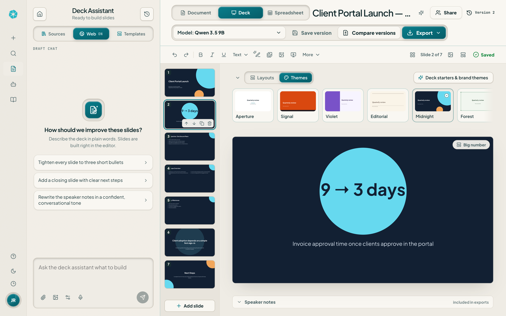 |

</details>

### Agents and automations

| Agents | Automations |
| --- | --- |
| 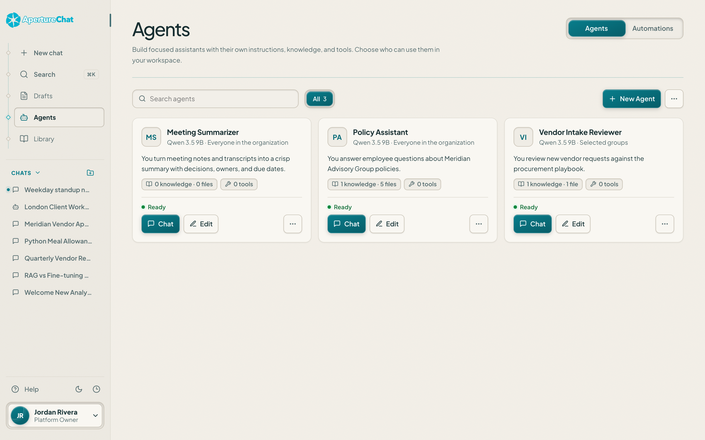 | 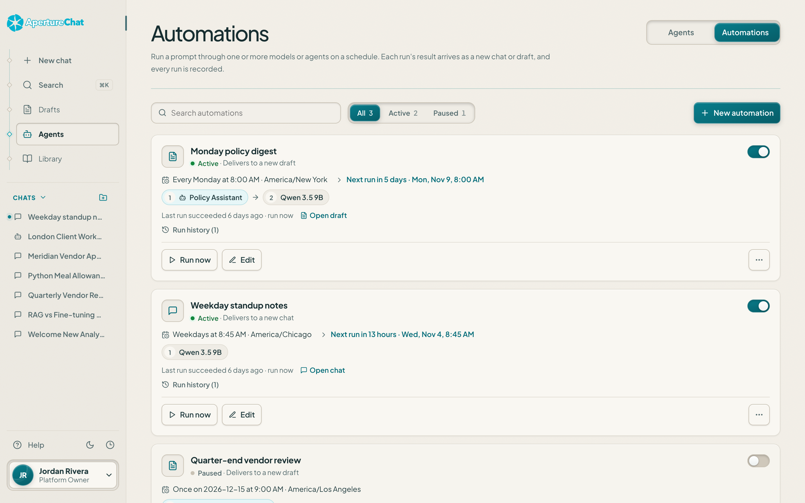 |

- **Agents** bundle instructions, a model, knowledge, tools, prompts, and skills into a reusable assistant. Choose who can use each one, check its readiness, and start from a template or duplicate an existing agent. Templates include **Contract Reviewer**, **Deposition Summarizer**, **Financial Analyst**, and **Client Memo Writer**.
- **Automations** run a prompt through one or more models or agents, once, weekly, or on a cron schedule in the time zone you choose. A live preview lists the next runs, and invalid schedules are rejected before they are saved. Recipes such as **Weekly matter status**, **Month-end variance commentary**, and **Regulatory watch** fill in a starting prompt and schedule.
- **Delivered where you work.** Each run arrives as a new chat or a new draft, and the last 10 runs, including **Run now**, are kept in the run history. Scheduled automations pause after three failures in a row.

### Library: knowledge and tools

| Knowledge | Tools |
| --- | --- |
| 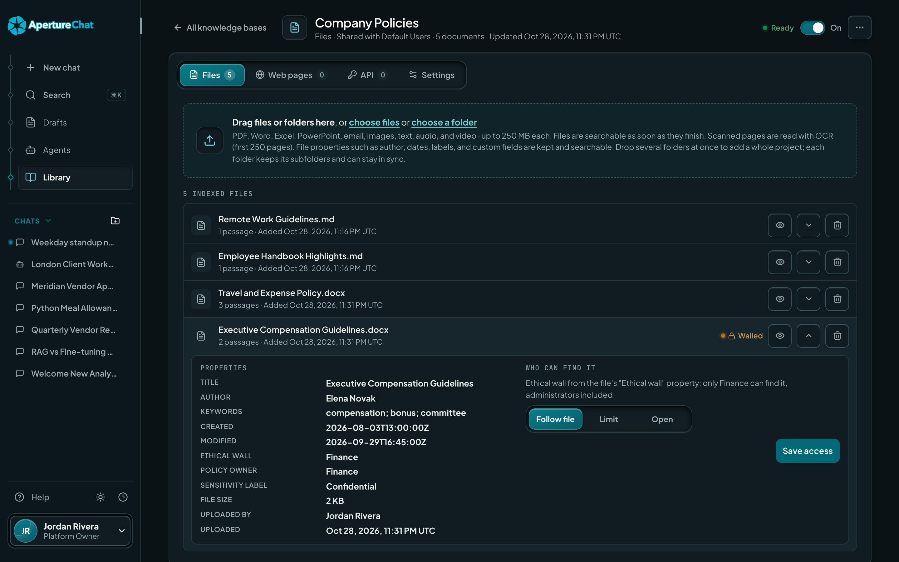 | 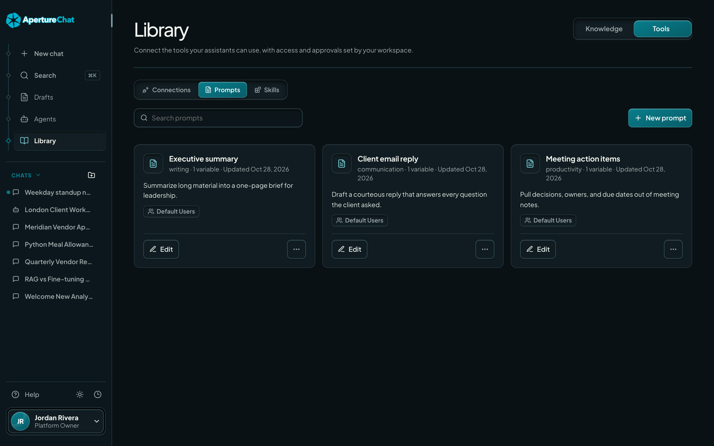 |

| Folder kept in sync | Filed under a matter |
| --- | --- |
| 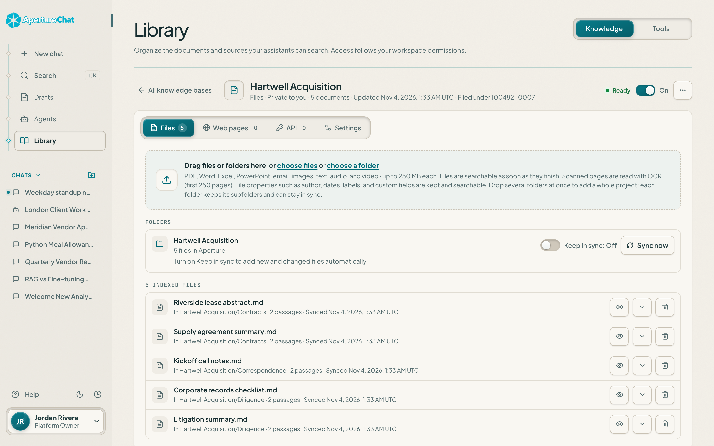 | 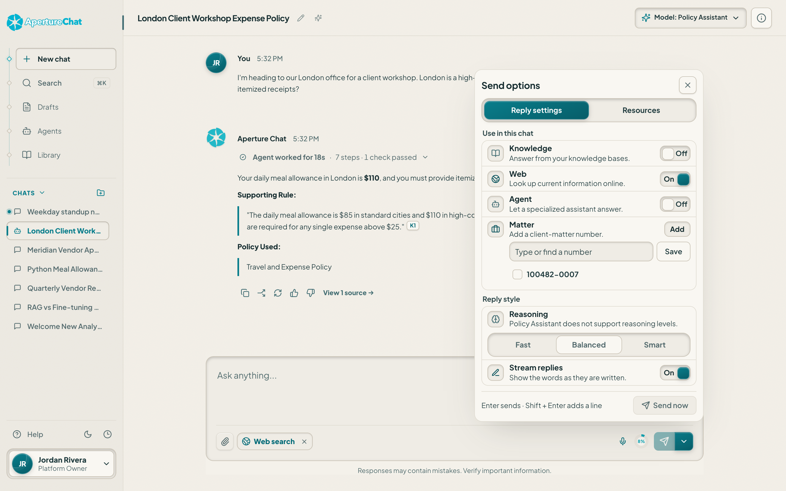 |

- **Knowledge bases** combine uploaded files, web pages, and API sources. Uploads are keyword-searchable as soon as their text is extracted, and semantic vectors are added in the background. Extraction keeps what plain text extraction drops: Word headers, footers, footnotes and comments, slide speaker notes, PDF reviewer comments and filled form fields, and email attachments. Each file's own properties (title, author, dates, custom fields, Microsoft Purview sensitivity labels, Box metadata, SharePoint columns, Google Drive properties) are kept, searchable, and shown beside every cited passage. Handwriting, stamps, and pictures are read by the workspace's image-capable model (for example Gemini Flash on OpenRouter or GPT-4.1 on Azure AI Foundry), with local OCR as the fallback; each knowledge base can keep pages on the server instead. Web pages can bring in the linked pages of the same site (robots.txt and sign-in pages respected, up to 100 pages), cite each exact page, and, when a question needs a page that was not read up front, look it up on that site live (its links, its own search box) and cite it. An **ethical wall** in a file's metadata (an "Ethical wall" or "Information barrier" field naming a group) limits that file to the group's members, administrators included. Embeddings run locally; audio and video are transcribed by a configured model.
- **Folders.** Drag in whole folders, several at once, or choose one. Each file keeps its subfolder, and uploading the same folder again adds new files, updates changed ones in place, and skips the rest; files you delete in Aperture stay out. Turn on **Keep in sync** to add new and changed files every few minutes while Aperture is open in that browser (Chrome and Edge; other browsers ask you to choose the folder again with **Sync now**). Files deleted on the computer are never deleted in Aperture.
- **Client-matter numbers.** Give a knowledge base an optional client-matter number when you create it or in its settings. The number shows on the card and in the header, and searching for it lists every base filed under it.
- **Sync** re-fetches web pages and API sources and never touches uploaded files. API requests pass the outbound guards and refuse redirects.
- **Cloud sources.** Connect Google Drive, Box, SharePoint, OneDrive, or iManage with the provider's credentials and permissions. A successful connection does not grant every user access to every document.
- **Tools** hold MCP connections, prompt templates, and skills. Connections are tested before they are saved, and tool use remains subject to workspace policy.

### Administration and identity

| Admin Console | Platform Owner Console |
| --- | --- |
| 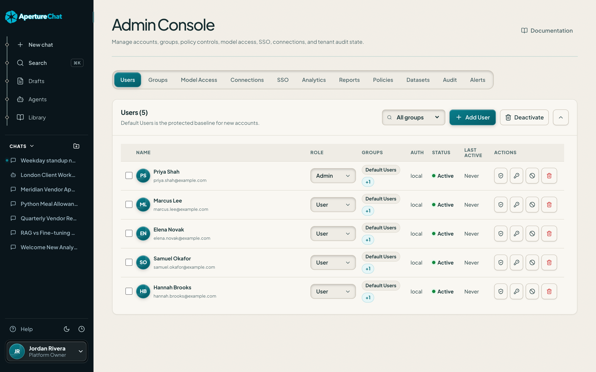 | 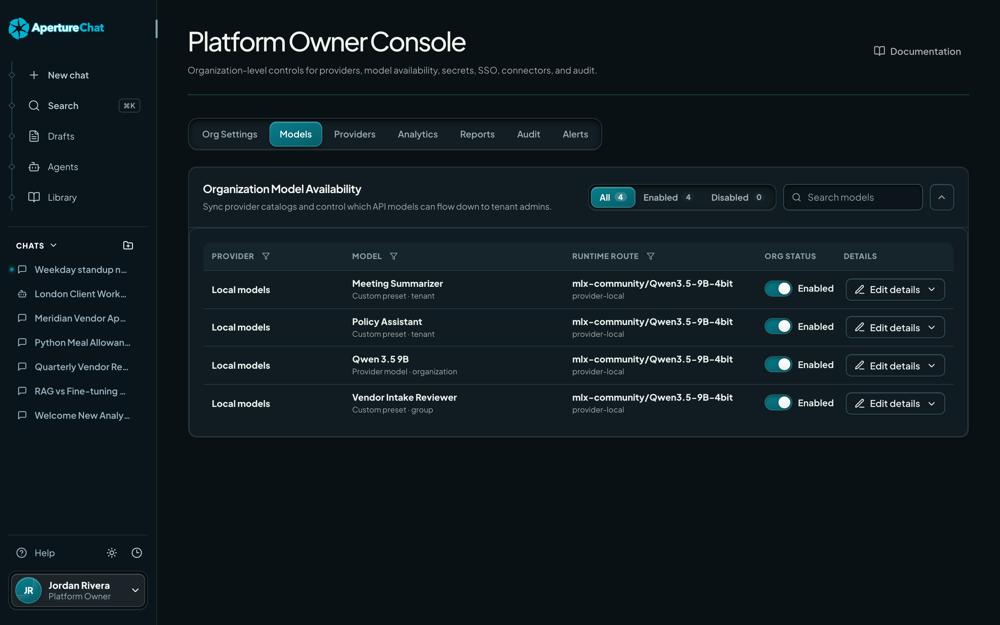 |

| Role | Responsibilities |
| --- | --- |
| **Platform Owner** | Providers and credentials, organization-wide model availability, the deployment-wide connector ceiling, organizations, branding, platform audit, alert email, Elastic export, and release updates. |
| **Tenant Admin** | Users, groups, access requests, SSO, model restrictions, connectors, knowledge, tools, policies, personal data protection, training datasets, retention, and tenant analytics. |
| **User** | Granted chat, drafting, agent, knowledge, and tool workflows. |

- **Sign-in.** OIDC with Entra ID, Google Workspace, Okta, or a custom provider; optional [WorkOS AuthKit](docs/WORKOS_SSO.md) with your own WorkOS account; SCIM 2.0 provisioning with its bearer token; local accounts with temporary-password rotation, authenticator setup, and recovery.
- **Secrets.** Provider and connector secrets are encrypted at rest and masked in the UI and API. Managing or revealing provider secrets requires platform-owner authorization; workspace admins can replace their own connectors' credentials but never read them back.
- **Personal data.** Optionally conceal Social Security, card, and account numbers, contact details, health identifiers, and secrets wherever chats are stored, shown, or exported, and keep them from the model. Detection runs inside your deployment.
- **Training datasets.** Optionally capture de-identified ratings and corrections, route them by practice area and department, review them, and download fine-tuning datasets for an open-weight model.
- **Oversight.** Administrative actions and chat activity feed audit and analytics views that fit the window you have. Filter each section to one person or several, export what you see as an Excel workbook or a CSV file, and open the conversation behind a runtime record. Audit dashboards group signals by what needs attention and chart trends, and every number opens its records. Alert rules can email on matching activity, including chosen prompt detections such as prompt injection. Owners can send audit, usage, chats, documents, and users to Elastic for Kibana. Tenant administrators see prompt activity only for the users they administer.
- **Support tickets.** Problem reports become tickets that admins work in a Reports tab and reporters follow in **Help › My reports**. Owners can share a redacted copy with the maintainers, who track it as a GitHub issue. See [support tickets](docs/SUPPORT_TICKETS.md).
- **Training.** Role-specific Help includes narrated walkthroughs and downloadable guides, with fullscreen playback on desktop and mobile.

## Get started

### Run a published release locally

Requires Docker Engine with Compose v2. Download and extract the Docker bundle
from a [reviewed release](https://github.com/Aperture-Chat/Aperture-Chat/releases),
then open a terminal in the extracted directory:

```bash
cp .env.example .env
# Edit .env before continuing:
#   APERTURE_IMAGE_TAG=v0.5.23
#   APERTURE_SECRET_KEY=<a unique, high-entropy secret of at least 32 characters>
docker compose -f docker-compose.release.yml --profile local pull
docker compose -f docker-compose.release.yml --profile local up -d
docker compose -f docker-compose.release.yml --profile local ps
```

Use the tag that matches your bundle, then open `http://localhost:5173`. A fresh
data volume has no seeded owner, demo users, or provider catalog: create the
first platform owner, then configure the installation.

Both the source and release Compose stacks enforce production authentication
and secret requirements, including with the `local` profile. The local profile
binds the API and web ports to loopback and does not enable development auth.

### Install on a VPS with HTTPS

With Docker Compose, Python 3, a DNS hostname, and ports 80/443 available, run
the installer from a reviewed release bundle:

```bash
python3 scripts/install-release.py --directory ./deployment --domain chat.example.com --tag v0.5.23 --start
```

Replace the domain and version. The installer writes private configuration, a
strong secret, and a stable Compose project identity, and it refuses to
overwrite an existing installation. Omit `--start` to review the configuration
before Docker starts, and complete first-owner setup immediately afterwards.
See [Docker deployment](docs/DOCKER_RELEASE.md) for manual HTTPS setup, forks,
private registries, and upgrades.

### First steps

1. Create the first owner account and store its credentials securely.
2. In the Platform Owner Console, add a provider and validate the connection.
3. Sync its model catalog and enable the models your organization should use.
4. Set up users and groups, grant models, and review access requests.
5. Add knowledge, connectors, agents, and tools deliberately, then check access as an ordinary user.
6. Send a real test message and check the response, sources, and audit records.

New users can request access from the sign-in screen, which also offers a
pre-login walkthrough. Users who receive a temporary password choose their own
when prompted.

<p align="center">
  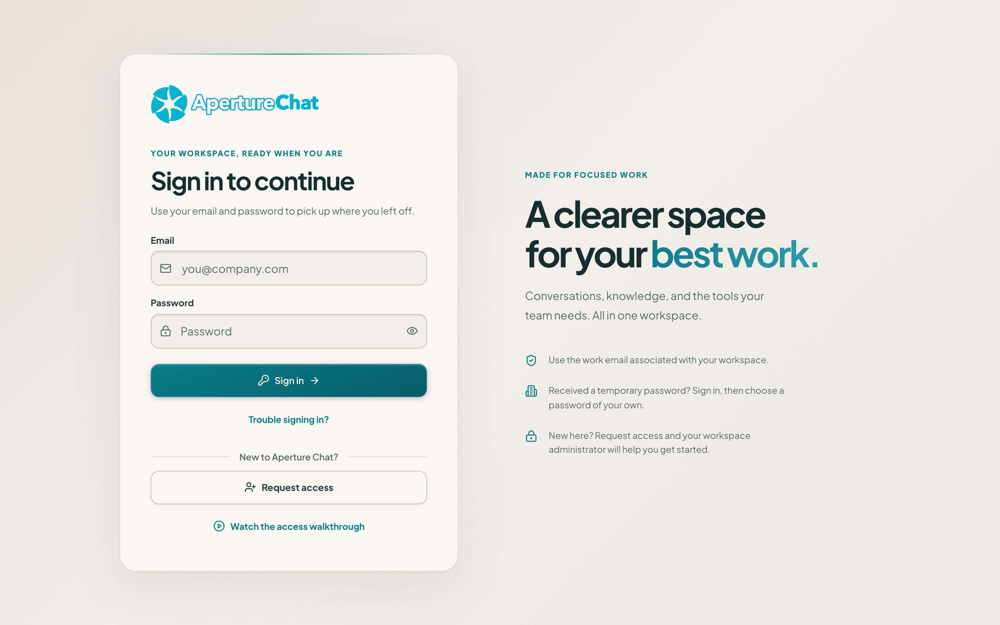
</p>

## Updates and images

Every release publishes multi-architecture (`linux/amd64`, `linux/arm64`) images
to `ghcr.io/aperture-chat/aperture-chat-api` and
`ghcr.io/aperture-chat/aperture-chat-web`.

| Tag | Use |
| --- | --- |
| `v0.5.23` | Reviewed stable release. Prefer a specific version for deployments. |
| `latest` | Moving alias for the newest stable release. |
| `dev`, `test`, `main` | Moving image pairs for each release branch. |
| `v0.5.23-dev`, `v0.5.23-test`, `v0.5.23-main` | Moving branch aliases for commits carrying that version. |
| `<branch>-<full-commit-sha>` | Commit-addressed builds. Record manifest digests for exact reproducibility. |

Changes are promoted **dev → test → main**. Both test images must be inspectable
before main is promoted, and a stable release reuses those inspected manifests
without rebuilding. Verify both the API and web digests, not just the tags.

The release stack includes an owner-controlled updater sidecar that pulls the
new image pair, recreates the API and web services, verifies health and version,
and attempts a rollback on failure. It has Docker-socket access and therefore
host-level control. Existing and source-built deployments need the manual setup
described in the deployment guide; a version notice alone does not install it.

Back up persistent data and private configuration before upgrading, and keep
the Compose project name, volume names, and signing secret unchanged. Never use
`docker compose down -v` for an upgrade. See the
[upgrade procedure](docs/DOCKER_RELEASE.md#upgrade) for migrations, recovery,
and manual updates.

## Architecture

| Path | Purpose |
| --- | --- |
| `apps/web` | React 19, TypeScript, Vite, and Vitest: the product UI and training media. |
| `services/api` | FastAPI: model routing, identity, policy, persistence, retrieval, and automation. |
| `services/api/app/db` | SQLAlchemy models, Alembic integration, and explicit import/transfer utilities. |
| `infra/caddy` | Reverse proxy and HTTPS configuration. |
| `infra/updater` | Release updater sidecar. |
| `docs` | Deployment, architecture, product images, and role guides. |

Application data spans SQL-backed state (SQLite by default), remaining JSON
state, and dedicated local stores such as the knowledge vector index. An
optional PostgreSQL Compose profile requires an explicit, verified migration and
`APERTURE_DATABASE_URL`; enabling the profile alone does not switch storage.
Back up the full data set and the secret, not just `runtime_state.json`.

The scheduler and some stores are process-local, so PostgreSQL alone does not
make multiple API replicas safe. Outbound protections block metadata and
link-local destinations and restrict private networks; allow required internal
hosts explicitly rather than disabling the protections. See
[architecture](docs/architecture.md) for details.

## Development

Requirements: Node.js 24+ (see `.nvmrc`), npm, and Python 3.12+.

```bash
cp .env.example .env
npm ci
python3 -m venv services/api/.venv
services/api/.venv/bin/python -m pip install -e './services/api[dev]'
```

Run the web app and the API in separate terminals:

```bash
npm run dev:web
```

```bash
cd services/api
.venv/bin/uvicorn app.main:app --reload --host 127.0.0.1 --port 8000
```

The API loads the root `.env`, and the Vite server proxies API requests to port
8000. A clean local instance can create its first owner without a provider key;
add and enable a model before testing generation. Local development can
generate a persisted signing secret when none is configured, while deployed
Compose stacks require an explicit strong secret.

To run source-built containers, configure `.env` (including the secret) and run:

```bash
docker compose --profile local up -d --build
```

Checks to run before submitting changes (see
[CONTRIBUTING.md](CONTRIBUTING.md#run-the-checks) for checks by area):

```bash
git diff --check
npm --workspace apps/web run typecheck
npm run test:web
npm run build:web
cd services/api && .venv/bin/ruff check . && .venv/bin/python -m pytest -q
```

## Contributing

Bug reports, ideas, documentation fixes, and code are all welcome. Read
[CONTRIBUTING.md](CONTRIBUTING.md) to get started. In short: fork the
repository, branch from `dev`, and open a focused pull request back to `dev`.
Maintainers review it and promote merged work through `test` to `main`. Issues
labeled [`good first issue`](https://github.com/Aperture-Chat/Aperture-Chat/labels/good%20first%20issue)
are a good place to start.

Never commit populated environment files, credentials, runtime databases,
production logs, or private deployment details. Screenshots and examples must
use synthetic data. Report vulnerabilities through [SECURITY.md](SECURITY.md).
Participation follows the [Code of Conduct](CODE_OF_CONDUCT.md), which is also
published at [aperturechat.com](https://aperturechat.com/code-of-conduct.html).

## Documentation

| Guide | What it covers |
| --- | --- |
| [Documentation index](docs/INDEX.md) | Reader paths and repository map. |
| [Docker deployment and release notes](docs/DOCKER_RELEASE.md) | Installation, image tags, updates, health checks, and recovery. |
| [Architecture](docs/architecture.md) | Services, access boundaries, persistence, and integrations. |
| [Personal data and training datasets](docs/PRIVACY_AND_TRAINING_DATA.md) | Concealment coverage, detectors, capture, routing, and dataset export. |
| [User guide (PDF)](docs/aperture-user-guide.pdf) | Chat, sources, drafts, and account help. |
| [Administrator guide (PDF)](docs/aperture-admin-guide.pdf) | Access, groups, policies, retention, and issue review. |
| [Platform owner guide (PDF)](docs/aperture-owner-guide.pdf) | Providers, organization controls, and operations. |
| [Training publication](docs/TRAINING.md) | Lesson sources and media regeneration. |
| [README image maintenance](docs/images/README.md) | How these screenshots and the tour are captured. |

## License

Aperture Chat is open source under the [MIT License](LICENSE.md). Anyone may
use, copy, modify, merge, publish, distribute, sublicense, and sell the
software, including commercially, provided the copyright and license notice
are included in all copies or substantial portions of it. The software is
provided as-is, without warranty.
